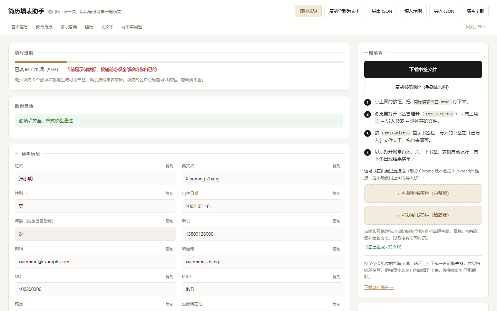

# 简历填表助手 · Resume Autofill

> 简历信息录一次，之后在任何一个企业网申页面点一下浏览器书签，整页表单自动填好。

**在线使用（无需下载、无需安装）**：<https://nefelibata857.github.io/resume-autofill/>



---

## 三种用法，按需选

| 你想怎么用 | 怎么做 |
|---|---|
| **在线用**（推荐，一分钟上手） | 打开上面的网址，填信息 → 下载书签文件 → 导入浏览器书签 |
| **下载到本地用**（不想依赖网站 / 想离线） | [点这里下载整个项目](https://github.com/Nefelibata857/resume-autofill/archive/refs/heads/main.zip)，解压后双击 `index.html` |
| **自己改**（换成你的行业、你的字段） | Fork 仓库或下载后改 `index.html`，详见 [修改指南](修改指南.md) |

> 下载版是完整功能：识别简历、生成书签、数据自检全都能用。
> 唯一区别是「识别 PDF」需要同目录的 `vendor/` 文件夹（一起下就在里面），别只单独拷 `index.html`。

---

## 它解决什么问题

秋招网申最耗时的不是投递本身，而是把姓名、手机、身份证、学校、专业、绩点、排名、三段实习经历……在几十个不同网站上一遍又一遍地手敲。北森、Moka、企业自建招聘后台，每家字段顺序都不一样，但内容永远相同。

这个工具把这些信息集中存一次，然后用浏览器书签（bookmarklet）在任意页面上执行一段脚本，自动识别字段并填入。

**纯前端、单文件、零依赖、不联网。** 数据只存在你自己浏览器的 localStorage 里，不会上传到任何服务器。

---

## 功能

| 能力 | 说明 |
|---|---|
| **简历自动识别** | 把 PDF / TXT 拖进页面，自动提取姓名、电话、邮箱、学校、专业、GPA、排名、经历、技能等，逐项预览确认后再写入 |
| **自定义字段** | 网申里出现上面没有的问题（是否有驾照、能否出差、身高等），自己加一行，书签就会按这个字段名去页面上找 |
| **70+ 字段集中管理** | 基本信息、教育背景、求职意向、三段经历、长文本（自我评价/技能/奖项），全部可视化编辑 |
| **一键填表书签** | 点击书签，自动填满当前网申页面；数据内嵌在书签 URL 里，随时可重新生成 |
| **只填空框** | 已手填的内容一律跳过，绝不覆盖 |
| **智能字段识别** | 从 `label`、`label[for]`、`placeholder`、`name`、`id`、相邻节点、父级文本多路推断字段含义 |
| **同源 iframe 递归** | 北森/Moka 这类把表单放进 iframe 的系统也能填进去 |
| **React / Vue 兼容** | 用原生 `value` setter + `input`/`change`/`blur` 事件，绕开受控组件的只读问题 |
| **下拉/单选/复选/日期** | 学历、性别、政治面貌等按选项文本模糊匹配；日期自动适配 `2023-09-01` / `2023年09月01日` / `2023/09/01` 三种格式 |
| **组件库下拉也能点** | Ant Design / Element / iView / TDesign 那种弹层下拉，会真的点开找选项再点中；省市区联动逐级往下选 |
| **结果面板** | 填完在右下角列出：填了哪些、哪些没识别、哪些下拉没有匹配项。未识别项可一键复制，方便补规则 |
| **诊断模式** | 换到没见过的招聘系统，先用诊断书签扫描整页字段名和当前值，只扫不填 |
| **数据自检** | 身份证校验位、手机号格式、入学是否晚于毕业、经历时间是否重叠、现居与通讯地址是否矛盾 |
| **导入/导出 JSON** | 换电脑、换浏览器时一键迁移；共用电脑时可一键清空 |
| **示例数据** | 一键填入虚构人物「张小明」，用来理解每个字段该写成什么格式 |
| **移动端可用** | 手机上可以填信息、生成书签文件，但装书签仍需在电脑上完成 |

---

## 快速开始

### 第 1 步：打开页面，填自己的信息

<https://nefelibata857.github.io/resume-autofill/>

**手上有简历 PDF 的话，先把它拖到页面顶部的虚线框里** —— 姓名、电话、学校、专业、GPA、经历会被自动挑出来，你只要核对勾选，能省掉一大半打字。

剩下的用手补：带黄点的字段标为「待补充」，不确定格式的字段有灰色示例提示（如 `2004-08-14`、`11 位手机号`）。性别、学历、政治面貌等是下拉可选也可直接输入。

### 第 2 步：生成并安装书签

页面右侧（手机端是右下角悬浮按钮）点「**下载书签文件**」，得到一个 `简历填表书签.html`。

然后在浏览器里：

1. `Ctrl + Shift + O` 打开书签管理器
2. 右上角 `⋮` → **导入书签** → 选中刚才那个文件
3. `Ctrl + Shift + B` 显示书签栏，导入的书签会在「已导入」文件夹里

> 不想导入文件？点「**复制书签地址**」，在书签管理器里 `⋮` → **添加新书签**，网址栏粘贴即可。这条路径 100% 可靠。
>
> 新版 Chrome 不允许把 `javascript:` 链接直接拖拽到书签栏，所以页面上的拖拽按钮只是备用。

### 第 3 步：去投简历

打开任何企业的网申页面 → 点一下书签栏里的「简历填表」→ 表单自动填好，右下角弹出结果面板。

---

## 为什么是「书签」而不是浏览器插件

- **浏览器插件**要过商店审核、要用户装扩展、要申请「读取所有网站数据」的权限，很多人不敢装。
- **书签脚本**只是当前标签页里执行一段 JS，关掉页面就没了。不需要安装、不需要权限申请、任何浏览器（Chrome / Edge / Firefox / Safari）都支持。

代价是：书签里存的是**数据快照**。你在面板里改了信息，必须**重新下载并导入一次书签**才会生效。页面顶部会在数据变化后提醒你「书签是旧的」。

---

## 它能填什么、填不了什么

**能填**：文本框、多行文本、下拉选择、单选、复选、日期、数字输入，以及同源 iframe 里的以上所有控件。

**组件库做的下拉也能填**：Ant Design、Element UI / Element Plus、iView、TDesign、Arco、layui、Select2、Chosen 这类「点开弹一层让你选」的下拉，脚本会真的点开、找到对应选项再点中。连**没有任何标准类名的自研组件**也认得——它不靠类名，而是看「这个框是不是只读、点开有没有浮层」。

**地区选择器（弹窗那种）也能填**：点开是「搜索框 + 勾选 + 确定」的面板时，脚本会把地名打进搜索框、回车、点中结果、再点确定。`陕西省汉中市洋县` 会优先找县一级，找不到退回市一级。省/市/区几个原生 select 联动时按顺序逐级选。

**标签按版面找**：有些系统（比如智联 zhiye 那类）的标签跟输入框在 DOM 上毫无关系，只是排版上在左边。脚本会按位置取「控件左侧同一行最近的文字」当标签，所以这类表单也能认出来。

**求职信息来源这类选项按优先级挑**：数据里用分号写优先级，例如 `学校;就业;官网;公众号;招聘网站;智联招聘`，表单里有哪一项就用哪一项。

**填不了**：

- **跨域 iframe**：如果表单在非同源的 iframe 里（部分企业自建系统），脚本进不去。结果面板会提示，需要点进 iframe 里再执行一次。
- **验证码**：短信验证码、图形验证码，必须手动。
- **虚拟滚动的超长列表**：候选太多时组件只渲染看得见的那几项，如果目标值埋在上千条里滚不到，会提示「下拉里没有这一项」，手动滚一下再选。
- **纯日历形态的日期控件**：只读输入框 + 弹日历、只能点格子不能打字的那种，脚本只填得上「能输入 / 能选年份」的，纯点格子的会跳过（乱点容易选错年月）。
- **上传控件**：简历附件、证件照，必须手动上传。
- **富文本编辑器**（部分系统的「自我评价」是 contenteditable）：只有部分实现支持。

---

## 常见问题

**点了书签没有任何反应？**
某些网站的 CSP 策略会禁止执行 `javascript:` 书签。按 `F12` 打开控制台 → `Console` → 在页面点「复制填表脚本」→ 粘贴回车。Chrome 首次会要求先输入 `allow pasting` 确认，照做即可。

**改了信息，填进去的还是旧的？**
书签是数据快照。重新下载书签文件并覆盖导入，或者点「复制书签地址」更新现有书签的 URL。

**某个字段一直填不上？**
点书签后看右下角结果面板的「未识别」列表，那里列出了所有没被识别的字段名。把那个列表复制出来提 issue，通常会补一条匹配规则就能解决。

**换电脑 / 换浏览器怎么办？**
在原设备点「导出 JSON」，新设备点「导入 JSON」，再重新生成一次书签。

**手机上能用吗？**
能填信息、能生成书签文件，但手机浏览器没有书签栏脚本机制，**装书签必须在电脑上**。正确顺序：电脑填 → 电脑装书签 → 电脑投简历。

**我的信息会被上传吗？**
不会。整个项目没有后端、没有埋点、没有第三方脚本。数据存在 `localStorage`，断网也能用。你可以打开开发者工具 → Network 面板验证：填表过程中零请求。

**共用电脑安全吗？**
点「清空全部」即可抹掉本机所有痕迹。但请注意：同一台电脑同一个浏览器配置文件下，多人数据会互相覆盖，建议各用各的浏览器或用户配置文件。

---

## 自动识别简历

页面顶部有一张「识别简历」卡片，支持三种输入：

1. **拖入 PDF** —— 自动提取文字层并解析（表格排版也会按阅读顺序还原）
2. **拖入 TXT** —— 直接读文本
3. **粘贴文字** —— 从任何地方复制简历正文粘进去，最稳

识别结果不会直接覆盖你的数据，而是列成一张表让你逐项确认：

- **默认勾选**：手机、邮箱、身份证、姓名等强特征项
- **默认不勾**：经历、排名这类容易误判的项（标 `low`）
- **与现有内容冲突的**：默认不勾，并标红显示「现有：xxx」，确认要覆盖再手动勾上

点「应用勾选项」才写入。所以识别错了也不会毁数据。

**扫描件 PDF（图片拼的）没有文字层，识别不了** —— 页面会明确提示，改用粘贴文字或先 OCR。

> 技术上：用的是 pdf.js，从同目录 `vendor/` 加载（离线可用），拿不到才回退 CDN。
> 中文 PDF 常见的「康熙部首码位」问题用 `normalize('NFKC')` 归一，否则「手机」会变成「⼿机」，一条规则都对不上。

---

## 自定义字段

企业网申总有些刁钻问题：是否有驾照、能否出差、是否服从调剂到外地、身高体重……

不用改代码，页面底部「自定义字段」卡片里直接加：

| 左边写 | 右边写 |
|---|---|
| 页面上那栏的标题，如 `是否有驾照` | 你要填的内容，如 `有` |

书签会去找标题里含这几个字的输入框。一个字段有几种叫法，用 `/` 隔开：

```
驾照/驾驶证/驾驶执照  →  有
```

自定义字段会一起存进浏览器、一起导出 JSON、也一起进书签。

---

## 下载到本地

**方式一：打包下载（推荐）**

<https://github.com/Nefelibata857/resume-autofill/archive/refs/heads/main.zip>

解压后得到：

```
resume-autofill/
├── index.html          ← 双击这个就能用
├── vendor/             ← 识别 PDF 用的 pdf.js，别删
│   ├── pdf.min.mjs
│   └── pdf.worker.min.mjs
├── assets/preview.png
├── 修改指南.md
├── README.md
└── LICENSE
```

**方式二：只要一个文件**

右键 [index.html](https://raw.githubusercontent.com/Nefelibata857/resume-autofill/main/index.html) → 另存为。

这样也能填信息、生成书签，但**识别 PDF 需要联网**（会从 CDN 取 pdf.js）。粘贴文字识别不受影响。

**离线能力**：除了「首次识别 PDF」，其余功能全部离线可用 —— 没有后端、没有埋点、没有网络字体。

---

## 自己修改

整个项目就是一个 HTML 文件，没有构建、没有 npm、没有依赖。用记事本打开就能改，存盘刷新即生效。

**[完整修改指南 →](修改指南.md)**

几个最常见的改法：

| 想改什么 | 搜这个 |
|---|---|
| 加 / 删字段 | `const GROUPS = [` |
| 让书签认新字段 | `var RULES = [` |
| 改识别简历的规则 | `function parseResumeText` |
| 改配色 | `:root{` |
| 改字段下拉选项 | `const ENUMS = {` |
| 改界面文案 | 直接搜那句话 |

改完记得：**数据或代码一变，旧书签就过期了，要重新下载一次书签文件。**

---

## 技术实现

单文件 HTML，含三部分：

1. **数据块** `<script type="application/json" id="resume-data">` —— 结构化字段，与逻辑代码解耦
2. **管理界面** —— 原生 JS 渲染，无框架
3. **填表引擎** `applyResume(D, OPT)` —— 独立函数，可 `toString()` 后注入到任意页面

字段识别是一条规则表：`[字段名, 正匹配正则, 负匹配正则]`。匹配文本来自多路上下文拼接（label / placeholder / name / id / aria-label / 相邻兄弟 / 父级纯文本），先严格匹配，失败后再向上扩两层兜底。

几处踩过的坑，写在代码注释里：

- 空正则 `/()/` 会永远 `test` 为 `true`，把排除逻辑整个废掉 —— 一律写 `null` 并判空
- 上下文向上扩展时必须过滤「包含 input/select/textarea 的兄弟节点」，否则会把相邻字段的文字算进来（表现为「毕业院校」被填成姓名）
- 下拉框默认选中「请选择」不能算「已有内容」，否则整组 select 被跳过
- 多段经历映射必须按 DOM 顺序对齐，而且要防止「公司名称」这类相邻字段被误当经历块字段
- 组件库下拉的真身是「readonly input + 异步渲染的弹层」，改 `value` 没用，只能点开等弹层再点选项 —— 所以主循环只登记待办，跑完再用一条异步队列一个个点
- 「值包含选项」这种反向模糊匹配要卡比例：`陕西省汉中市` 会被选项 `陕西省` 截胡，导致省市区联动连第一级都走不下去

书签生成时会做一步「删注释 + `new Function` 语法校验」的轻量压缩，失败则回退原文 —— 保证压缩不会把功能弄坏。完整版书签 URL 约 59 KB。

---

## 本地运行 / 自建

```bash
git clone https://github.com/Nefelibata857/resume-autofill.git
cd resume-autofill
# 直接双击 index.html，或用任意静态服务器
python -m http.server 8000
```

不需要构建、不需要 npm install、不需要 Node。所有代码在 `index.html` 里。

想改字段或匹配规则，直接编辑 `index.html`：搜索 `const GROUPS`（面板字段定义）、`const RULES`（匹配规则表）、`function applyResume`（填表引擎）。

---

## 贡献

欢迎提 Issue 反馈某个招聘系统填不上的字段。有效的反馈格式是：

```
网站：某企业网申（或某招聘系统名）
现象：学历下拉没选中
未识别字段名：最高学历（必填）
```

如果能提供该页面的 HTML 结构片段（F12 → 右键元素 → Copy → Copy outerHTML），补规则会很快。

---

## License

[MIT](LICENSE) —— 随便用、随便改、随便商用。
